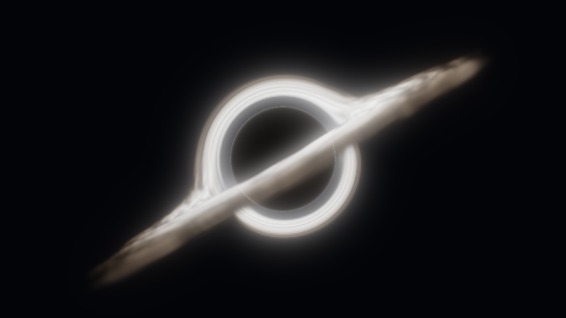

# 黑洞系统使用说明（1.1.0）

本功能加入现有 OverHeaven Foliage Compat，模组 ID 保持 `overheaven_foliage_compat`。Minecraft 1.20.1、Java 17，Forge 47.4.10（支持范围 `[47.4.10,48)`，与实际实例一致）。现有植物委托修复仍独立工作。

## 安装与基本行为

发行文件：`build/libs/overheaven_foliage_compat-1.20.1-forge-1.1.0.jar`。手动放入实例的 `mods` 目录，并移除旧版本补丁；不能同时安装两个相同模组 ID 的版本。不要安装 sources/dev 工件。

黑洞完整功能要求服务端与观看客户端都安装本版本。单人游戏由内置服务器管理记录；专用服务器只加载命令、存档、网络等公共代码。客户端单独安装仍可使用植物兼容修复。网络通道允许对端缺席，只向声明支持通道的客户端发送数据；未安装补丁的玩家不会看到黑洞，黑洞没有碰撞、引力或伤害。

命令权限等级为 2。记录由服务端权威管理，ID 跨维度唯一，最多 256 个。没有实体、持续服务端 tick 或区块强加载；位置所在区块卸载后记录仍保存。第一版以同屏一个黑洞为视觉和性能基准，多个黑洞独立排序合成，不求联合引力场。

## 快速体验

```mcfunction
/overheaven blackhole spawn demo ~ ~5 ~20
/overheaven blackhole info demo
/overheaven blackhole set demo glow 1.2
/overheaven blackhole set demo playing false
/overheaven blackhole set demo playing true
/overheaven blackhole preset demo reference
/overheaven blackhole remove demo
```

第一条在执行命令时的维度、玩家前后坐标轴所指定的位置生成；`~ ~5 ~20` 是世界轴相对坐标，不是玩家朝向，亦支持 `^ ^5 ^20` 本地坐标。控制台使用绝对坐标。

## 服务端命令

| 命令（公共前缀 `/overheaven blackhole`） | 行为 |
| --- | --- |
| `spawn <id> <x> <y> <z>` | 在命令所在维度生成参考图预设；拒绝重复 ID |
| `remove <id>` | 按全局 ID 删除 |
| `move <id> <x> <y> <z>` | 移入命令所在维度及指定位置 |
| `list` | 列出命令所在维度的记录 |
| `info <id>` | 查看维度、位置与全部外观设置 |
| `set <id> <属性> <值>` | 原子修改并广播；校验失败时保留原值 |
| `preset <id> reference` | 恢复外观与动画默认值；保留 ID、维度、位置和随机种子 |
| `clear` | 删除命令所在维度的全部记录 |

ID 允许 1–48 位 ASCII 字母、数字、`_`、`.` 和 `-`。坐标必须有限且绝对值不超过 3000 万。数值拒绝 NaN、Infinity、越界及无效几何关系。几何始终要求 `radius < inner < outer`；扩大整体尺寸时先改外半径，再改内半径，最后改核心，缩小时顺序相反。

| 属性 | 默认值 | 允许范围 / 含义 |
| --- | --- | --- |
| `radius` | 3.2 | 0.1–128，核心半径（方块） |
| `inner` | 3.8 | 0.1–128，吸积盘内半径；必须大于核心 |
| `outer` | 11 | 0.1–128，吸积盘外半径；必须大于内半径 |
| `thickness` | 0.12 | 0.02–16，体积盘厚度参数（方块） |
| `tilt` | 30 | −360–360 度，盘面法线偏离世界 Y 轴的角度；0 为水平盘 |
| `yaw` | −83 | −360–360 度，盘面朝向的世界方位角 |
| `hotColor` | `#fff9f2` | 内侧高温颜色，`#RRGGBB` |
| `coldColor` | `#98765d` | 外侧尘埃颜色，`#RRGGBB` |
| `brightness` | 3.2 | 0–8，辐射亮度倍率 |
| `rotation` | 0.25 | −4–4，盘纹旋转速度参数，支持反向 |
| `infall` | 0.12 | −4–4，径向纹理流速参数，支持反向 |
| `lensing` | 1 | 0–8，艺术化弯曲/背景偏折强度 |
| `glow` | 0.7 | 0–8，独立低分辨率辉光强度 |
| `playing` | true | 严格使用 `true` 或 `false` |

颜色命令的值需加双引号，例如：

```mcfunction
/overheaven blackhole set demo hotColor "#fff9f2"
/overheaven blackhole set demo coldColor "#98765d"
```

动画使用服务端主世界时间基准及记录内相位、epoch；登录、换维度发送快照，增删改发送增量，不逐帧发包。暂停/恢复保持时间相位连续。修改 rotation/infall 以新速度重算纹理，可能出现相位变化；不保证变速连续。时间刻度随世界 tick，网络延迟或客户端暂停恢复可能造成小幅相位修正。

存档使用主世界 `data/overheaven_blackholes.dat`，schema=1，包括全维度记录和稳定随机种子。有效记录会被往返保存，坏记录给出日志，未知 schema 会报告错误；升级前按普通存档流程备份。移除模组不会主动删除这个存档文件。

## 客户端质量与诊断

```mcfunction
/blackholeclient quality low
/blackholeclient quality balanced
/blackholeclient quality high
/blackholeclient diagnostics true
/blackholeclient diagnostics false
```

| 档位 | 基础积分步数 | 求解宽高比例 | 1920×1080 对应求解尺寸 |
| --- | --- | --- | --- |
| low | 24 | 0.375 | 720×405 |
| balanced（默认） | 48 | 0.5 | 960×540 |
| high（常态及演出黑洞阶段） | 最多 512 个 Kerr RK4 步 | 1.0 | 1920×1080 |
| high（显现后的奇点） | 原演出场求值 | 1.0 | 1920×1080 |

质量与命令诊断设置仅影响本客户端，保留到客户端进程退出，不写入实例配置文件。也可在启动器 JVM 参数中设置 `-Doverheaven.blackhole.diagnostics=true`。诊断用异步时间戳查询，约每 120 个就绪样本汇总采集、表面、求解/合成、Oculus 前景阶段的 GPU 耗时，以及分辨率、样本档位、可见数和适配路径；不逐帧刷屏，不同步读取场景像素。

没有可见黑洞时不执行采集、求解、辉光或合成 pass。已分配 GPU 资源会复用，在尺寸变化时重建，在资源重载、切换世界、退出服务器和游戏关闭时释放。可见性包含视锥、2048 方块加主体包围体的距离和屏幕矩形剔除。

## 外观与渲染设计

参考预设使用世界坐标盘面、薄盘体积、暖灰褐色尘埃、白热内盘、黑暗核心和弯曲亮弧；不默认包含喷流、独立粒子或白洞。主体、盘面与透镜结构随实际相机矩阵变化。low、balanced 保留艺术化光路；high 的常态、演出开场及回归黑洞阶段使用下面说明的 Kerr 光路及热辐射近似，显现后的奇点继续使用演出场。这仍不属于完整天体物理模拟。

主求解降低分辨率；核心交点和最终深度判断使用全分辨率，低分辨率结果在深度/核心边界不一致时回退全分辨率求解。解析包围球裁剪、薄盘交点、低透射率提前终止减少无效采样。辉光按辐射深度过滤，墙前不能仅凭模糊核直接泄漏整片亮斑。

自有渲染目标保存不透明颜色/深度、透明透射/表面深度、前后辐射、背景偏折和辉光。不会替换 Minecraft 的全局 PostChain，不调用终焉图书馆的新深度接口，不关闭其效果。GL 状态保存与恢复覆盖 framebuffer、viewport、program、VAO、纹理/采样器、深度/写入、混合和逐附件混合/颜色掩码等。

原版普通图形路径在透明阶段临时借用最终颜色的 alpha 累积覆盖率，结束时恢复旧 alpha；高品质透明路径读取独立透明目标，并合入物品/实体深度。透明表面前后分段积分，按采集的透射率合成，玻璃不会直接变成实心墙。水的颜色和折射由宿主维持，不另建完整透明深度剥离。

Oculus 开启光影时不能等到 AFTER_LEVEL 才写入 HDR 场景：该时刻宿主已经完成其 composite 链。当前专用适配器在 beginTranslucents 结束处采集不透明层，在 finalizeLevelRendering 开始处加入后侧辐射，随后在实际 composite1 折射绘制结束处加入前侧辐射，再让其余光影阶段继续。原版路径在 Forge AFTER_LEVEL 合成。两者都先于实际 EndingLibrary GameRenderer.renderLevel TAIL 世界后处理。此时序来自匹配版本 JAR 的调用核对，不依赖同一点优先级竞争。

## 支持门控与限制

| 场景 | 实现/检查范围 | 游戏验收 |
| --- | --- | --- |
| 原版 Forge，Oculus 未安装或关闭光影 | 独立原版透明适配路径 | 待执行 |
| Embeddium 0.3.31 | 核对 RenderType 调用及现有植物绘制顺序 | 待执行 |
| Oculus 1.8.0 + ComplementaryUnbound_r5.9.3.zip | 核对实际 API、深度、colortex0/3、composite1 及 ZIP 指纹 | 待执行 |
| EndingLibrary 2.2.1fix | 核对实际后处理注入时序，无新接口调用 | 待执行 |
| FWA 1.2.31 | 保留原植物补丁和宿主渲染流程 | 待执行 |
| 其他光影包 / Euphoria 修改版 | 未支持，记录诊断并跳过黑洞光影渲染 | 不声明兼容 |

当前光影白名单要求文件名及 SHA-256 同时匹配：

```text
ComplementaryUnbound_r5.9.3.zip
98ac741dee294d2a3c82d153349148c3bb7fb688c30eb3b49c3b9ac37e968c5a
```

不修改 ZIP 内容；改名、替换版本、启用修改版或改变预期缓冲尺寸/程序结构会被拒绝。Oculus 不支持的版本与目标字节码结构会明确诊断并跳过可选 Mixin。着色器/缓冲错误会暂停黑洞渲染，资源重载后可重试；不会通过让主体穿墙降级。

屏幕空间背景偏折不能重建画面之外或被遮挡的背景，采样不可用时回退原图。多层玻璃/水沿用宿主排序与累计透射，未实现完整逐层深度剥离；复杂透明实体、TAA 历史与运动矢量、远处精度及水下雾的最终表现须在游戏中确认。黑洞不写宿主材质 G-buffer 或自身运动矢量，不能预先承诺所有光影时域效果无拖影。

## 文件与验证

- 公共系统：`src/main/java/com/mega/overheaven/foliagecompat/blackhole/`。
- 客户端渲染：上述目录下的 `client/`；新增注入位于 `blackhole/mixin/` 目录。
- 着色器：`src/main/resources/assets/overheaven_foliage_compat/shaders/blackhole/`。
- 预设描述：`src/main/resources/assets/overheaven_foliage_compat/blackhole/presets/reference.json`，与 Java 默认值一致；它不是客户端资源包覆写服务端状态的入口。
- 验证与性能记录：[BLACK_HOLE_VALIDATION.md](BLACK_HOLE_VALIDATION.md)。



上图由生产 GLSL 在独立 OpenGL 测试中生成，使用参考默认材质与辉光；不能代表实际游戏中的光影、曝光、终焉后处理或地形遮挡验收结果。

## 2026-10-26：盘面材质与辉光改进

当前发行包保留 reference 命令预设及全部参数，新增自有周期采样材质、分层尘埃与细纹、薄层双点积分、低分辨率柔光及原版高光显示曲线。参考来源、实现边界、纹理生成方法和验证说明见 [Shadertoy 参考记录](SHADERTOY_REFERENCE.md)。最初原站访问失败；后续盘面改造已经直接查看原站，各阶段以对应记录为准。不是原 shader 的完整移植。Oculus 继续使用宿主显示转换。

当前环境透镜独立于盘面积分：采用有限影响区方向偏折，无透明层时取完整场景背景，使晚绘制内容参与同一映射；相机处于影响范围内明确启用全屏矩形。保留四点源保护、透明前后合成与内侧 0–50% 饱和度曲线。实现、实测性能和限制见 [环境透镜修复记录](LENS_ENVIRONMENT_FIX.md)。先前 [近距离透镜记录](NEAR_CAMERA_FIX.md) 为历史证据；当前游戏内复现场景仍需验收。


## 2026-10-29：渲染稳定性与资源开销

当前实现保留奇点、星轨、冲击波及八阶段演出风格。Oculus 后层合成同时保存当前主体的前层辐射与透射，前层随后只合成自己的辉光，不再次进行重建或体积积分。每帧建立一次完整场景快照，后续主体只刷新前一主体改写的区域；宿主折射后的前层合成仍有独立场景捕获。

求解和辉光目标按有效矩形清理及采样，矩形外使用中性值。覆盖整个目标时选择无局部范围分支的等价 shader；局部目标仍逐样本检查范围。重建先取四点，不足时扩展至十六点，再保留完整积分兜底。环境透镜在最终像素解析求值，不再插值不连续的低分辨率映射坐标；无效或被遮挡的来源仍退回有效背景，波面与色散不能抹掉基础透镜。

盘纹采用两组错开四秒、各八秒周期的有限剪切更新，在材质覆盖率与辐射系数阶段平滑混合；周期重置时该组权重为零。mip 足迹来自有限相位和空间足迹，不随服务器累计运行时间持续增加。同步时间使用双精度计算有界相位；暂停和晚加入不依赖帧历史。零旋转时不启动剪切更新。

原版不分配 Oculus 前景附件。宇宙路径使用 1×1 远深度与单位透射常量，并以真实画面尺寸计算采样足迹；不再保留整屏不透明和透明副本。当前维度连续 30 秒没有黑洞记录且无演出时回收大型目标，单纯转头不可见不回收。重载、退出及失败清理会释放新增目标与程序；嵌套宿主 FBO 作用域内的世界路径失败延至下一个安全帧边界清理，并保持失败锁定直到重载或切换世界。纯黑期间不绘制星空或主体，停止／恢复仍维持世界与宇宙画面的独立合成。

现有 diagnostics 开关现在按路径、阶段、分辨率和质量档保留异步查询的归属，输出 GPU／CPU 分段的均值、p95、p99、最大值、主体数、合成像素量及渲染目标占用估算。父级区间包含子项，不能重复相加；诊断分类绘制单列，主体还报告扣除该绘制的时间。每 120 帧低频统计完整积分回退比例，不阻塞等待查询结果。目标占用不包含宿主、NASA 星图、盘面材质、驱动缓存或全部 GPU 内存。

独立 OpenGL 夹具用于比较当前实现和固定基线，包括前层缓存、局部快照、旧数据拒绝、有限相位与长期纹理细节。它不证明实际 Minecraft、Oculus、Complementary、EndingLibrary 组合已经通过游戏验收；不将 GPU 时间直接换算为游戏 FPS。

## 2026-10-30：暗核、盘面亮暗侧与碎片移除

普通黑洞不再产生独立发光描边。暗核只吸收后方背景，射线此前累积的前景盘辐射仍保留；边缘亮度来自盘面及其偏折影像。开场收紧描边使用独立演出包络，辉光提取和最终合成共用同一个源函数。

盘面弱光雾宽度为 `max(0.12R, 1.5×盘厚)`，系数为 `0.035`，在内缘以内归零。径向辐射按 `r⁻³ × (1−√(内半径/r))` 的形状归一化，峰值在 `49/36 × 内半径`，超出实际外半径时以外半径截断归一化区间；窄盘的外缘渐隐也按实际盘宽定位。盘纹、双相更新、颜色及尺寸参数继续沿用。

气体切向速度遵守盘面世界坐标基和 `rotation` 正负号，观察方向使用采样处弯曲射线的反方向。`β=min(0.45,0.30×√(|rotation|/0.25)×√(内半径/r))`，辐射乘以 `D³`，其中 `D=√(1−β²)/(1−βμ)`。这里是有界实时视觉近似，不是完整相对论求解；亮暗方向参考 [NASA 黑洞可视化说明](https://svs.gsfc.nasa.gov/13326/)。颜色偏移限制在 8% 以内。旋转为零时增益为一，暂停不改变亮暗关系；吸收、环境透镜与全屏曝光不乘该增益。

普通黑洞最大两级辉光各保留原贡献的 40%，其余尺度不变，并保留原归一化分母。均匀辐射输入下，低／均衡／高档的总辉光比为 0.60／0.70／0.76；这不是整幅画面的亮度倍率。开场收紧时平滑恢复原演出辉光，完全显现后的奇点不受此调整影响。没有增加体积步数、全屏通道或渲染目标。

玻璃裂纹、玻璃碎片、建筑碎屑及其专用程序、位置/形状纹理和两种玻璃声音已删除。新演出不扫描或修改现场，网络字段顺序不变，两组数组发送为空；客户端在保存旧端快照前清空非空碎片数据。历史恢复日志、预留位置保护、占位延后与恢复后落盘仍保留。能量冲击、波面、相机反馈和最终白闪不受影响。

本轮固定当前源码快照进行独立 RTX 3060 对照，1080p、均衡档、相同渲染顺序：远景 0.343→0.326 ms，近景 2.134→2.120 ms，透明前后段近景 2.851→2.830 ms，前后段细遮挡 3.190→3.171 ms，普通细遮挡 2.285→2.298 ms，三个主体 4.027→4.021 ms。六组增量均低于 `max(0.1 ms, 基线5%)`；这些是独立主体路径测量，不包含游戏宿主或整帧性能。

均匀材质、固定视角下，正转／反转／零旋转的左右辐射比分别为 2.161／0.463／1.000。GPU 检查覆盖 Doppler 公式、颜色界限、窄盘、前景盘保留、原版/透明分段、墙体与镂空遮挡、资源释放及 GL 状态恢复。旧通用夹具已改用生产双相盘纹，并将“普通暗核必须发光”的过时断言替换为普通暗核零辐射与开场描边保留。Java 编译、网络兼容、历史恢复日志和 14 个保留声音素材检查通过。Oculus／Complementary／EndingLibrary 的实际组合画面仍待游戏内确认。

## 2026-10-30：high 统一光路、自旋与演出接入

`/blackholeclient quality high` 启用 Kerr 模型，默认无量纲自旋 `a/M=0.6`。用 `/blackholeclient spin <数值>` 在 `-0.95…0.95` 内调整；`0` 为非旋转极限。此参数与质量档一样属于本次客户端会话，全体黑洞共用，不写入服务端存档，也不新增同步字段。自旋轴由盘面坐标基决定，正方向为 `DiskRight → DiskForward`；`rotation` 的正负独立决定气体顺转或逆转。

high 全程使用原生分辨率保存同一条射线的前后辐射、透射率和背景映射，合成取对应像素，不插值不同光路的背景坐标。演出开场和回归阶段不再被排除；收缩包络缩放盘面及质量，捕获消退包络进一步缩小质量，盘辐射随后按原包络退出。显现后的奇点、喷流、冲击波与白闪仍按原时序执行，high 的奇点求解结果也按原生像素读取。low、balanced 的光路与分辨率保持原样。没有替换宿主后处理链。

### 质量档专用参数解释

- 取 `G=c=1`，引力长度 `M = radius × lensing / √27`，世界长度单位为方块。`radius` 是非旋转、`lensing=1` 时无限远阴影的参考冲量尺度，不是视界。Kerr 的视界 BL 半径为 `M(1+√(1−(a/M)²))`，旋转阴影不再是半径 `radius` 的圆。未指定现实质量或太阳质量换算。
- `lensing` 同时缩放质量、捕获范围、光线弯曲、ISCO、轨道速度和频移。有效内缘取 `max(inner, Kerr ISCO)`，由自旋与气体顺逆转共同决定；达到外缘时不绘制稳定盘。盘半径按 BL 坐标解释，嵌入世界时赤道为扁球坐标。零质量使用直线盘积分，无捕获或引力频移。
- 默认质量仍为 `M≈0.61584`。`spin=0` 时恢复 `r_h=2M`、光子球 `3M`、ISCO `6M`；存档数值不改写。演出阶段的几何收缩属于美术包络，并非时变 Einstein 场解。
- 相机射线通过当地 ZAMO 正交标架初始化，保留实际相机的位置与朝向，不加入玩家速度的相对论像差。气体角速度为 Kerr 圆轨道值 `Ω=±1/[M((r/M)^(3/2)±a/M)]`，频移由观察者及发射者四速度与同一射线的能量、角动量计算。零自旋时退回 Schwarzschild 的引力、横向及纵向 Doppler 频移。
- `rotation` 正负决定轨道方向，绝对值只控制动画时间；零值冻结纹理运动，不把圆轨道气体的瞬时速度抹掉。径向纹理流和双相更新仍为美术动画，不是流体模拟。`infall` 不伪装成径向自由落体速度。

### 光线与颜色

在 Mino 参数下积分 Kerr 分离测地线。径向使用 `u=M/r`，极向使用单位球切向量，轴向拖曳单独积分，避免穿过旋转轴时除以 `sinθ`，也避免视界附近坐标绕行耗尽角度步。每个片元最多 512 个 RK4 步，极向步控制在约 0.06 弧度，径向及近视界另有限制。每段盘交点都参加辐射积分，因此高阶影像来自同一条绕行光路，不是叠加的装饰光圈。没有额外射线束或时间累积抗锯齿，低于像素的极细高阶环仍可能闪烁。

捕获在视界外约 `0.1%` 的数值截断处终止，保留此前累积的前景辐射；逃逸方向也来自同一轨道。临界轨道超出步数预算时保留已累积辐射并拒绝未知背景。ZAMO 无法定义在视界内，内部相机及无法归一化的零 Killing 能量方向安全退为有限黑暗输出。旧 Schwarzschild 求解器保留作独立解析回归参照。

每条光路同时积累坐标传播时间，在每个盘采样点用发射时刻查询材质。使用 `80 方块/动画秒` 作为光程到演出时间的视觉换算，而非现实光速或真实吸积率；绕行较久的影像会显示较早盘纹。CPU 将双精度时钟拆成有界周期和相位，GPU 先减去光程再选择两组材质周期，支持跨周期延迟、暂停、晚加入和长期运行，无帧历史缓存。发射时刻早于零时使用确定性的材质延拓。延迟作用于盘纹，不延迟世界、演出指令、奇点或冲击波。

盘温度来自归一化 `r⁻³(1−√(r_in/r))` 辐射轮廓及材质亮度，温度取辐射通量的四次方根。参考峰温为默认质量下 12000 K；固定 Eddington 比例的视觉归一化使峰温随 `M⁻¹/⁴` 缩放。这是选定的吸积盘参考，不是从游戏世界推算出的真实吸积率。将总频移作用于温度后，按 Planck 光谱采样 16 个可见光波段，积分近似 CIE XYZ 并转换为线性 RGB。没有再重复乘旧的 `D³` 或另一遍 `g⁴`。`hotColor`、`coldColor` 是频移后乘上的美术调色；设为白色可去除该调色。HDR 输出保留有限上限，防止贴近视界的静止观察者频移令半浮点缓冲溢出。

high 盘面发射曝光比此前降低一档，材质分为较暗连续气体和较亮细丝。辉光只从盘面高亮部分平滑提取，抑制大尺度灰雾；奇点阶段恢复原演出辉光。原版路径只对本效果的发光使用保色显示压缩，Oculus 路径继续输出线性 HDR，交由光影包完成显示转换，不改宿主曝光。

公式依据：James et al. (2015), [Kerr 光线、ZAMO 与 Carter 常量，附录 A.1](https://arxiv.org/abs/1502.03808)；Bardeen, Press & Teukolsky (1972), [圆轨道及 ISCO](https://www.osti.gov/biblio/4585183)；Belbruno & Pretorius (2011), [Schwarzschild 参照](https://arxiv.org/abs/1103.0585)；Wyman, Sloan & Shirley (2013), [CIE XYZ 拟合](https://jcgt.org/published/0002/02/01/paper.pdf)。实现自行编写。径向辐射仍采用薄盘轮廓近似，并非完整 Novikov–Thorne 通量；有限波段、灰吸收、厚盘离开赤道的圆轨道外推及纹理输运也是实时近似，没有磁流体或全频谱吸收。

### 世界接入与代价

继续使用宿主不透明深度与透明前后分层，并以相机到采样点的距离判定遮挡，不能把绕行光程当作游戏深度。它不是对 Minecraft 网格进行弯曲光线求交。环境仍只来自屏幕副本：离屏、被遮挡或未解析的透明源回退原图；位于有限透镜支持区内的宿主表面也不套用无限远背景的整段偏折。支持半径为 `max(1.35×outer+2×thickness,32M)`，外侧四分之一区域只渐隐背景混合权重，不改动轨道方程。

沿用已有四附件求解目标、局部矩形、前层缓存和释放流程，没有新离屏通道。1080p 原生求解目标约 94.9 MiB；相对原先 0.75 分辨率的演出主体增加约 41.5 MiB，普通 high 与上一轮相同。其他目标不计入此差值。`RelativisticGpuVerification` 覆盖解析阴影、正负自旋捕获、零自旋极限、ISCO、传播延迟与材质时钟，以及旧档、遮挡、透明缓存、演出阶段和资源恢复。独立 GPU 检查不能代替 Oculus／Complementary／EndingLibrary 的游戏验收。

显式复跑任务为 `verifyRelativisticGpu`，必须用 `-PblackHoleBaselineShaders=<修改前着色器目录>` 指定对照源，可用 `-PblackHoleVerificationDir=<不存在的新目录>` 指定输出；基线也须保留相邻的 `../../textures/blackhole/disk_detail.png`。该任务不挂到 `check`，不依赖打包任务，不启动游戏；首次使用或构建配置变更后先加 `--dry-run` 核对任务图。日志工作目录也设为新输出目录，不轮转实例日志。
