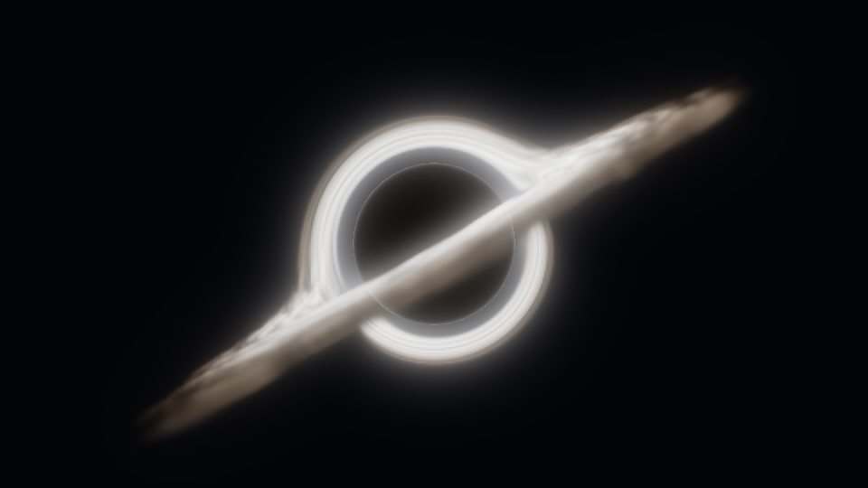

# 黑洞系统使用说明（1.1.0）

本功能加入现有 OverHeaven Foliage Compat，模组 ID 保持 `overheaven_foliage_compat`。Minecraft 1.20.1、Java 17，Forge 47.4.10（支持范围 `[47.4.10,48)`，与实际实例一致）。现有植物委托修复仍独立工作。

## 安装与基本行为

发行文件：`build/libs/overheaven_foliage_compat-1.20.1-forge-1.1.0.jar`。手动放入实例的 `mods` 目录，并移除旧版本补丁；不能同时安装两个相同模组 ID 的版本。不要安装 sources/dev 工件。

黑洞完整功能要求服务端与观看客户端都安装本版本。单人游戏由内置服务器管理记录；专用服务器只加载命令、存档、网络等公共代码。客户端单独安装仍可使用植物兼容修复。网络通道允许对端缺席，只向声明支持通道的客户端发送数据；未安装补丁的玩家不会看到黑洞，黑洞没有碰撞、引力或伤害。

命令权限等级为 2。记录由服务端权威管理，ID 跨维度唯一，最多 256 个。没有实体、持续服务端 tick 或区块强加载；位置所在区块卸载后记录仍保存。第一版以同屏一个黑洞为视觉和性能基准，多个黑洞独立排序合成，不求联合引力场。

## 快速体验

```mcfunction
/overheaven blackhole spawn demo ~ ~5 ~20
/overheaven blackhole info demo
/overheaven blackhole set demo glow 1.2
/overheaven blackhole set demo playing false
/overheaven blackhole set demo playing true
/overheaven blackhole preset demo reference
/overheaven blackhole remove demo
```

第一条在执行命令时的维度、玩家前后坐标轴所指定的位置生成；`~ ~5 ~20` 是世界轴相对坐标，不是玩家朝向，亦支持 `^ ^5 ^20` 本地坐标。控制台使用绝对坐标。

## 服务端命令

| 命令（公共前缀 `/overheaven blackhole`） | 行为 |
| --- | --- |
| `spawn <id> <x> <y> <z>` | 在命令所在维度生成参考图预设；拒绝重复 ID |
| `remove <id>` | 按全局 ID 删除 |
| `move <id> <x> <y> <z>` | 移入命令所在维度及指定位置 |
| `list` | 列出命令所在维度的记录 |
| `info <id>` | 查看维度、位置与全部外观设置 |
| `set <id> <属性> <值>` | 原子修改并广播；校验失败时保留原值 |
| `preset <id> reference` | 恢复外观与动画默认值；保留 ID、维度、位置和随机种子 |
| `clear` | 删除命令所在维度的全部记录 |

ID 允许 1–48 位 ASCII 字母、数字、`_`、`.` 和 `-`。坐标必须有限且绝对值不超过 3000 万。数值拒绝 NaN、Infinity、越界及无效几何关系。几何始终要求 `radius < inner < outer`；扩大整体尺寸时先改外半径，再改内半径，最后改核心，缩小时顺序相反。

| 属性 | 默认值 | 允许范围 / 含义 |
| --- | --- | --- |
| `radius` | 3.2 | 0.1–128，核心半径（方块） |
| `inner` | 3.8 | 0.1–128，吸积盘内半径；必须大于核心 |
| `outer` | 11 | 0.1–128，吸积盘外半径；必须大于内半径 |
| `thickness` | 0.12 | 0.02–16，体积盘厚度参数（方块） |
| `tilt` | 30 | −360–360 度，盘面法线偏离世界 Y 轴的角度；0 为水平盘 |
| `yaw` | −83 | −360–360 度，盘面朝向的世界方位角 |
| `hotColor` | `#fff9f2` | 内侧高温颜色，`#RRGGBB` |
| `coldColor` | `#98765d` | 外侧尘埃颜色，`#RRGGBB` |
| `brightness` | 3.2 | 0–8，辐射亮度倍率 |
| `rotation` | 0.25 | −4–4，盘纹旋转速度参数，支持反向 |
| `infall` | 0.12 | −4–4，径向纹理流速参数，支持反向 |
| `lensing` | 1 | 0–8，艺术化弯曲/背景偏折强度 |
| `glow` | 0.7 | 0–8，独立低分辨率辉光强度 |
| `playing` | true | 严格使用 `true` 或 `false` |

颜色命令的值需加双引号，例如：

```mcfunction
/overheaven blackhole set demo hotColor "#fff9f2"
/overheaven blackhole set demo coldColor "#98765d"
```

动画使用服务端主世界时间基准及记录内相位、epoch；登录、换维度发送快照，增删改发送增量，不逐帧发包。暂停/恢复保持时间相位连续。修改 rotation/infall 以新速度重算纹理，可能出现相位变化；不保证变速连续。时间刻度随世界 tick，网络延迟或客户端暂停恢复可能造成小幅相位修正。

存档使用主世界 `data/overheaven_blackholes.dat`，schema=1，包括全维度记录和稳定随机种子。有效记录会被往返保存，坏记录给出日志，未知 schema 会报告错误；升级前按普通存档流程备份。移除模组不会主动删除这个存档文件。

## 客户端质量与诊断

```mcfunction
/blackholeclient quality low
/blackholeclient quality balanced
/blackholeclient quality high
/blackholeclient diagnostics true
/blackholeclient diagnostics false
```

| 档位 | 基础积分步数 | 求解宽高比例 | 1920×1080 对应求解尺寸 |
| --- | --- | --- | --- |
| low | 24 | 0.375 | 720×405 |
| balanced（默认） | 48 | 0.5 | 960×540 |
| high | 96 | 0.75 | 1440×810 |

质量与命令诊断设置仅影响本客户端，保留到客户端进程退出，不写入实例配置文件。也可在启动器 JVM 参数中设置 `-Doverheaven.blackhole.diagnostics=true`。诊断用异步时间戳查询，约每 120 个就绪样本汇总采集、表面、求解/合成、Oculus 前景阶段的 GPU 耗时，以及分辨率、样本档位、可见数和适配路径；不逐帧刷屏，不同步读取场景像素。

没有可见黑洞时不执行采集、求解、辉光或合成 pass。已分配 GPU 资源会复用，在尺寸变化时重建，在资源重载、切换世界、退出服务器和游戏关闭时释放。可见性包含视锥、2048 方块加主体包围体的距离和屏幕矩形剔除。

## 外观与渲染设计

参考预设使用世界坐标盘面、薄盘体积、暖灰褐色尘埃、白热内盘、黑暗核心、细亮边缘和弯曲亮弧；不默认包含喷流、独立粒子或白洞。主体、盘面与透镜结构随实际相机矩阵变化。算法是面向游戏的有限步艺术化求解，不宣称广义相对论数值模拟。

主求解降低分辨率；核心交点和最终深度判断使用全分辨率，低分辨率结果在深度/核心边界不一致时回退全分辨率求解。解析包围球裁剪、薄盘交点、低透射率提前终止减少无效采样。辉光按辐射深度过滤，墙前不能仅凭模糊核直接泄漏整片亮斑。

自有渲染目标保存不透明颜色/深度、透明透射/表面深度、前后辐射、背景偏折和辉光。不会替换 Minecraft 的全局 PostChain，不调用终焉图书馆的新深度接口，不关闭其效果。GL 状态保存与恢复覆盖 framebuffer、viewport、program、VAO、纹理/采样器、深度/写入、混合和逐附件混合/颜色掩码等。

原版普通图形路径在透明阶段临时借用最终颜色的 alpha 累积覆盖率，结束时恢复旧 alpha；高品质透明路径读取独立透明目标，并合入物品/实体深度。透明表面前后分段积分，按采集的透射率合成，玻璃不会直接变成实心墙。水的颜色和折射由宿主维持，不另建完整透明深度剥离。

Oculus 开启光影时不能等到 AFTER_LEVEL 才写入 HDR 场景：该时刻宿主已经完成其 composite 链。当前专用适配器在 beginTranslucents 结束处采集不透明层，在 finalizeLevelRendering 开始处加入后侧辐射，随后在实际 composite1 折射绘制结束处加入前侧辐射，再让其余光影阶段继续。原版路径在 Forge AFTER_LEVEL 合成。两者都先于实际 EndingLibrary GameRenderer.renderLevel TAIL 世界后处理。此时序来自匹配版本 JAR 的调用核对，不依赖同一点优先级竞争。

## 支持门控与限制

| 场景 | 实现/检查范围 | 游戏验收 |
| --- | --- | --- |
| 原版 Forge，Oculus 未安装或关闭光影 | 独立原版透明适配路径 | 待执行 |
| Embeddium 0.3.31 | 核对 RenderType 调用及现有植物绘制顺序 | 待执行 |
| Oculus 1.8.0 + ComplementaryUnbound_r5.9.3.zip | 核对实际 API、深度、colortex0/3、composite1 及 ZIP 指纹 | 待执行 |
| EndingLibrary 2.2.1fix | 核对实际后处理注入时序，无新接口调用 | 待执行 |
| FWA 1.2.31 | 保留原植物补丁和宿主渲染流程 | 待执行 |
| 其他光影包 / Euphoria 修改版 | 未支持，记录诊断并跳过黑洞光影渲染 | 不声明兼容 |

当前光影白名单要求文件名及 SHA-256 同时匹配：

```text
ComplementaryUnbound_r5.9.3.zip
98ac741dee294d2a3c82d153349148c3bb7fb688c30eb3b49c3b9ac37e968c5a
```

不修改 ZIP 内容；改名、替换版本、启用修改版或改变预期缓冲尺寸/程序结构会被拒绝。Oculus 不支持的版本与目标字节码结构会明确诊断并跳过可选 Mixin。着色器/缓冲错误会暂停黑洞渲染，资源重载后可重试；不会通过让主体穿墙降级。

屏幕空间背景偏折不能重建画面之外或被遮挡的背景，采样不可用时回退原图。多层玻璃/水沿用宿主排序与累计透射，未实现完整逐层深度剥离；复杂透明实体、TAA 历史与运动矢量、远处精度及水下雾的最终表现须在游戏中确认。黑洞不写宿主材质 G-buffer 或自身运动矢量，不能预先承诺所有光影时域效果无拖影。

## 文件与验证

- 公共系统：`src/main/java/com/mega/overheaven/foliagecompat/blackhole/`。
- 客户端渲染：上述目录下的 `client/`；新增注入位于 `blackhole/mixin/` 目录。
- 着色器：`src/main/resources/assets/overheaven_foliage_compat/shaders/blackhole/`。
- 预设描述：`src/main/resources/assets/overheaven_foliage_compat/blackhole/presets/reference.json`，与 Java 默认值一致；它不是客户端资源包覆写服务端状态的入口。
- 验证与性能记录：[BLACK_HOLE_VALIDATION.md](BLACK_HOLE_VALIDATION.md)。



上图由生产 GLSL 在独立 OpenGL 测试中生成，使用参考默认材质与辉光；不能代表实际游戏中的光影、曝光、终焉后处理或地形遮挡验收结果。

## 2026-10-26：盘面材质与辉光改进

当前发行包保留 reference 命令预设及全部参数，新增自有周期采样材质、分层尘埃与细纹、薄层双点积分、低分辨率柔光及原版高光显示曲线。参考来源、实现边界、纹理生成方法和验证说明见 [Shadertoy 参考记录](SHADERTOY_REFERENCE.md)。最初原站访问失败；后续盘面改造已经直接查看原站，各阶段以对应记录为准。不是原 shader 的完整移植。Oculus 继续使用宿主显示转换。

当前环境透镜独立于盘面积分：采用有限影响区方向偏折，无透明层时取完整场景背景，使晚绘制内容参与同一映射；相机处于影响范围内明确启用全屏矩形。保留四点源保护、透明前后合成与内侧 0–50% 饱和度曲线。实现、实测性能和限制见 [环境透镜修复记录](LENS_ENVIRONMENT_FIX.md)。先前 [近距离透镜记录](NEAR_CAMERA_FIX.md) 为历史证据；当前游戏内复现场景仍需验收。
