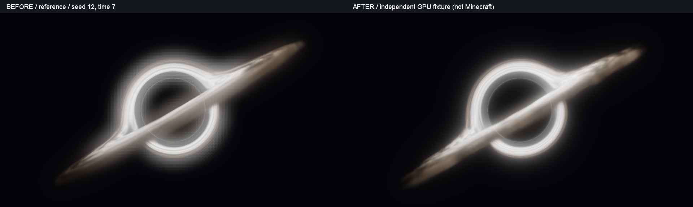

# 吸积盘、局部薄雾与 HDR 辉光改造（2026-10-26）

本轮沿用 reference 记录及所有命令/网络/存档字段，已有黑洞无需重建。默认 glow=0.7；glow=0 关闭局部薄雾和屏幕辉光，直接盘光和核心细边仍保留。

## 实现

- field.glsl：自有周期纹理的覆盖率与发光强度独立调制；以角向团块、径向拉长细丝代替正弦等距条纹，内侧白热、外侧暖灰褐色。保留种子、角向旋转、径向内流、显式 LOD、角向整数周期与薄盘双点光程积分。
- 有限环状薄雾仅增加 RGB 辐射，不改变前后段透射 alpha。按采样光程、glow、亮度及盘面剩余透射积分；使用原来的透明面分段、场景深度上限与核心截断。范围外跳过指数计算。
- GlBloom / bloom.fsh：四分之一分辨率起始，24/48/96 步分别为 3/4/5 层。逐级减半、帐篷上采样、归一化组合；各层保留 HDR。核心细边以全分辨率像素位置提取到辉光源，直接细边仍只由最终合成绘制一次。
- 辉光目标的颜色使用 GL_LINEAR；场景深度仍是 GL_NEAREST。辐射距离打包在 RGBA16F 的 alpha 中，使用 texelFetch 逐点读取和判定，不对距离插值；过滤只对通过深度检查的 RGB 加权。最终全分辨率合成再次检查四个辉光采样点与场景深度。
- 主体求解只使用投影包围范围；合成及各层辉光使用依据滤波支撑半径扩展的范围。球外也合成受深度约束的光晕，消除旧 20px 边距及球外直接返回带来的裁切。
- 同尺寸复用目标，缩放/档位切换只重建必要目标；重载、退出、切世界沿用 renderer.close 释放所有层。没有可见黑洞时沿用入口剔除；glow=0 不运行金字塔。没有逐帧分配目标、读回像素或 glFinish。
- 原版路径保留自身显示转换；Oculus 前后段仍保留 HDR，交给宿主转换。未改变原版、Oculus、EndingLibrary 注入点和执行顺序，也未接管 PostChain。

此次没有引入参考源码或外部纹理。原站 lstSRS 的盘面覆盖/辐射分离、局部 Haze 与多尺度 HDR 辉光仅作为视觉和算法思路参考；没有复制其 200 步、时间累积或 atlas 实现。独立原创实现并非精确相对论模拟或逐像素复刻。

## 验证范围

隐藏 GLFW / OpenGL 3.3 上下文直接运行发行 shader 和生产 GlBloom；没有启动 Minecraft。固定 seed=12、time=7，输出默认、正面、侧面、背面、近距离的修改前后 PNG。均为合成夹具，不能代替 Minecraft 截图。

新增 GPU 检查：glow=0/0.7/1.4；薄雾没有新增吸收；零辉光忽略旧纹理；整墙和棋盘镂空前景；黑色透射层截断后段但保留前段；单独细边进入辉光源；同尺寸复用、奇数窗口尺寸、3/4/5 层切换、释放与重建、颜色/深度过滤、真实金字塔操作后的 GL 状态恢复。保留角向接缝、动画、薄盘、24/48/96 亮度收敛及近距离手部重影/屏幕边缘重投影夹具。

合成棋盘/透明夹具不是实际树叶、实体、玻璃、水材质。实际水面折射、Oculus + Complementary + EndingLibrary、第一/第三人称、资源包重载及真实窗口切换仍须游戏验收。独立 close/resize 检查不等于已执行游戏内 F3+T。

运行方式（Java 17、离线 FG 缓存）：

gradlew.bat --offline -I audit/disk-bloom-2026-10-26/gpu.init.gradle verifyBlackHoleGpu verifyBlackHoleLens build -Dnet.minecraftforge.gradle.check.certs=false --console=plain

审计目录：audit/disk-bloom-2026-10-26。before/after 为源码快照，before.jar 为修改前发行包。此目录不是 Git 仓库；使用 git diff --no-index --check 检查快照。未初始化仓库、提交或推送。

## 游戏验收

1. 既有黑洞默认 reference，正面/侧面/背面/近距离移动；查看盘面团块和白热细丝、灰白核心晕染、轮廓及细节。
2. 分别设置 /overheaven blackhole set <id> glow 0、0.7、1.4，确认关闭后仍有直接盘光，增强后仍能辨认盘纹。近距离检查背景条带和手部复制。
3. 完整墙、墙边、树叶孔洞、前景实体，第一/第三人称；玻璃和水的前后、以及水下观察。
4. Oculus 关闭光影和已核对的原版 Complementary Unbound r5.9.3 开启光影；两种情况都测试 EndingLibrary 效果启停、次序和残留。
5. 24/48/96 步档位、窗口缩放、F3+T、重进世界/换维度/退出；没有黑洞时确认不执行黑洞 pass。
6. 回归 Interactive Foliage + SWAY + Embeddium 植物交互及 FWA 动画。此轮植物补丁源码未变化。

支持边界仍为 Minecraft 1.20.1、Java 17、Forge 47.4.10，实际实例 EndingLibrary 2.2.1fix / Embeddium 0.3.31 / Oculus 1.8.0。其他光影包不扩大兼容声明。保留 FG 远程依赖，无本地 JAR 或 compileOnly。

## 最终结果与交付

完整日志：audit/disk-bloom-2026-10-26/final-check.log。完整构建成功；29,419,292 项独立 OpenGL 检查和 13,807,165 项近距离检查通过（包含大量逐像素有限值/相等断言，不代表同等数量的独立场景）。15 组近距离视点/质量组合的前景复制像素均为 0。24/48/96 步固定场景 HDR 均值为 0.41968 / 0.42663 / 0.43370，最大/最小约 1.0334。

72 项命令/存档/网络检查、692 项 API/注入/隔离检查、97 项植物兼容检查、模型委托、38 项守卫和 1,761 项发行包/重映射检查通过。

RTX 3060 / NVIDIA 560.94 / 1080p，同一隐藏 OpenGL 上下文交替执行新旧生产 shader，每档三批、每批 24 帧，另有预热，取批均值中位数：

| 档位 | 改造前 | 改造后 | 增量 |
| --- | ---: | ---: | ---: |
| 低：24 步，720×405，3 级辉光 | 0.842 ms | 1.127 ms | +0.284 ms |
| 均衡：48 步，960×540，4 级辉光 | 1.147 ms | 1.720 ms | +0.573 ms |
| 高：96 步，1440×810，5 级辉光 | 2.803 ms | 4.322 ms | +1.519 ms |

这是全屏合成夹具的求解+辉光+合成时间，不包含场景采集、Minecraft、Oculus 或 EndingLibrary；不等同于游戏帧率或组合效果的增量。实际生产渲染额外使用投影范围 scissor，夹具采用全屏，以固定条件比较。GPU 时钟和系统负载会影响数字。

默认视角对照：

其余正面/侧面/背面/近距离的 before、after、comparison，以及 glow-0.0/0.7/1.4 图像位于 audit/disk-bloom-2026-10-26/gpu/。docs/blackhole-preview.png 已更新为本轮默认视角。

测试 JAR：E:\CollapsingWorld\System-e\OverHeaven\mod\build\libs\overheaven_foliage_compat-1.20.1-forge-1.1.0.jar

大小：913540 字节；生产类：36。SHA-256：

4617410F0241358DFE0EB2DB97885C1414D453062149A003625ED7461E2B512C

版本号仍为 1.1.0，请以本次 SHA-256 区分旧测试包。关闭游戏后手动替换原补丁 JAR，勿并存两个同 mod ID 的版本。已有黑洞保留 ID、位置、参数和动画状态，无需存档迁移。不自动安装、启动游戏、修改实例配置或发布。
