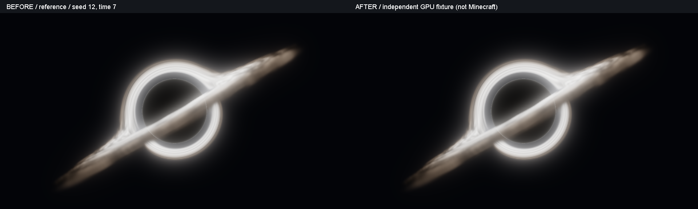

# 环境透镜层次与范围内相机修复

日期：2026-10-26。Minecraft 1.20.1 / Forge 47.4.10 / Java 17，版本 1.1.0。
本轮基于已经撤回深度追踪重构后的源码；没有恢复 lens_query.glsl 或逐步深度搜索。

## 观察事实、推导与未验证部分

### 已观察事实

- 原版 Opaque 颜色在透明地形前捕获，Scene 在 AFTER_LEVEL 合成时复制。已核对的 Forge LevelRenderer 在透明/粒子之后绘制云，GameRenderer 再触发 AFTER_LEVEL。
- 旧 composite 对每个像素无条件计算 host - transmission * Opaque 作为固定原位的 surfaceRadiance。没有透明表面的像素也留下了 Scene 与早期 Opaque 的差值，导致晚绘制内容不随透镜移动；这不是单纯交换 GPU 深度测试顺序能解决的问题。
- 同一独立 GL 上下文已复现旧实现反例：固定偏折源为 (0.7,0.7)，背景使用坐标渐变模拟晚绘制云；旧结果为 (0.499756,0.499756)，新结果为 (0.699219,0.698730)。夹具位于画幅中心，排除了屏幕边缘回退。
- 旧背景 UV 来自盘面积分的最后位置/方向，受原像素深度、核心直线距离、吸收提前结束和采样步数约束，天空还使用 4096 单位的外推点。
- 旧 CPU 投影已有包围盒跨眼点时的全屏回退。因此不能声称已经证明 CPU 包围盒是用户抬头缺口的唯一原因。新代码对光学眼点位于球内作显式全屏保证，并独立测试。

### 代码推导

将环境偏折从材质积分中分离，可避免盘面提前结束引起的背景映射变化；用实际 VP 投影方向，不依赖任意天空平面的距离/深度裁剪。范围内抬头时，有限影响区域内向外的射线仍有非零的横向引力积分，不再依赖“质量必须在眼前”的角度筛选。

### 待运行验证

没有启动 Minecraft。尚未在用户原场景确认全部症状已消失；透明层、无深度云、光影后续通道仍有下述限制。独立 GPU 图像不是游戏截图。

## 参考项目及采用范围

阅读了用户指定目录 E:/minecraft-agent-skills-vfx-workbench-0.1.0-20261010 下的文档、BlackHoleWorld.java、bh_world.fsh（尤其 resolveLensSource/environmentFootprint）和 world-regression.md；参考文件 SHA-256 见 audit/lens-layers-2026-10-26/reference-manifest.json。

参考贡献：环境映射与盘面辐射分开；实际相机矩阵；晚绘制内容的采集时机；源颜色四点足迹保护；范围内、俯仰和前景回归。参考实现的 theta<1.50 限制和对地形的美术遮挡选择未移植；没有复制其材质、纹理、实体扫描或源码段。目录许可证为 MIT（Roxio-sketch），参考关系在此明确记录。本项目保持自身严格前景边界与现有透明合成契约。

## 本次实现

### field.glsl：独立的有限区间方向偏折

沿相机原始视线取影响球内、原像素可见深度前的区间 [first,last]。把质量方向分解为轴向 along 和垂直分量 transverse，设 b=length(transverse)，q=b²+Radius²/16，t=s-along。横向弱场积分为：

~~~text
integral = t_last/sqrt(q+t_last²) - t_first/sqrt(q+t_first²)
angle = min(1.2, 0.4 * Radius * Lensing * b/q * integral * window)
window = 1 - smoothstep(0.72*extent, extent, b)
~~~

围绕垂直分量旋转原视线，再用 VP * vec4(direction,0) 投影方向。属于有限影响区的弱场/美术近似，**不是**求解 Schwarzschild/Kerr 光路，不宣称有真实隐藏几何或透镜多重像。保留半径软化和最大转角保护。

映射在盘面积分前计算；不受吸积盘透明度、采样步数或辉光控制。仍在直视核心后抑制背景，不改变原盘光轮廓；glow=0、内侧 0–50% 饱和度、薄雾、材质和存档参数保留。没有新增命令、网络字段或迁移。

meta.w 仍表示源距离保护阈值（不是求交结果），现在为 min(opaque,max(entry,Radius))。四点源深度拒绝近物；源超出当前画幅时沿用颜色混合回退，不夹 UV 拉出屏幕边缘条纹。源位于屏外、不可见世界或多层透明后时不伪造内容。

### composite.fsh：区分完整背景和真实透明表面

无透明表面的像素，原背景与偏折源都取 Scene，并将 surfaceRadiance 置零；该层包含本次采集前已完成的宿主颜色，不再把晚绘制内容当作贴在原位置的表面。

有透明表面的像素仍使用 Opaque、Transmission、surfaceRadiance 的原有前后层合成，避免整体扭曲水面/玻璃。完整 Scene 的偏折源足迹若含独立透明表面则回退，不跨像素带走未知水面/玻璃贡献。SurfaceDepth 在重建权重计算前归一到 OpaqueDepth，避免无透明层时因极小深度差触发全分辨率重算。

相同逻辑用于原版合成与 Oculus 原有折射前背景合成，不新增注入点或调整 EndingLibrary 顺序。

### Java、资源与成本

- 新 BlackHoleScreenBounds：把投影计算抽为可直接验证的复用对象；光学眼点在影响球内时矩形明确等于完整 viewport，范围外保留裁剪/距离判断。使用缓存 Vector4f，逐帧不新增对象。
- BlackHoleRenderer：采用该矩形；lens MRT 从 RGBA16F 升为 RGBA32F，减轻半精度 UV 量化。均衡档 960×540 时该附件额外约 3.96 MiB。总 MRT 数、采集次数、纹理单元 0–10、资源缩放/释放及 GL 状态范围不变。
- 不新增渲染 pass、世界重绘、深度搜索、历史帧、同步回读或生产 glFinish；无可见黑洞仍跳过自有 pass。
- 新 verifyBlackHoleEnvironment 为显式独立 GPU 任务。修正性能夹具，使基线使用本轮修改前的多尺度辉光和 RGBA16F lens，当前使用 RGBA32F，避免拿早期 Gaussian 版充当基线。
- Java 包名 com.mega、ForgeGradle 远程依赖和植物兼容代码均未改动。

## 自动验证及图像

日志：audit/lens-layers-2026-10-26/final-check.log。

- 新环境测试：2,672,682 次断言（包含逐像素检查，不代表同等数量独立场景）；晚绘制背景负例、Oculus 背景模式、透明源拒绝、整墙不变、七个真实俯仰 VP（-89/-60/-30/0/30/60/89 度，附 roll/yaw）、范围外背面剔除、零 lensing 元数据。
- 相机位于球内时，各俯仰 CPU 矩形都是全屏；58,101 像素中可投影到当前屏内的非原位 UV 为 41,006–46,859。剩余像素可因核心、轴向零偏折或屏外源回退而保持原背景，**全屏绘制不等于强制每个像素发生形变**。
- 24/48/96 步的方向映射逐像素一致；没有依靠关闭背景偏折通过测试。
- 近距离回归：13,807,189 次检查，15 组场景的前景复制像素均为 0；四点深度、屏幕边缘、UV 不连续保护和色度曲线通过。
- 常规 GPU：29,419,292 次检查；盘面、辉光三档、透明前后光、整墙/孔洞、重建/缩放及 GL 状态回归通过，无 GL 错误。
- build 成功，发行包检查 1766、数据/命令/同步 72、API/注入/客户端隔离 692、植物兼容 97、委托验证和 guard 38 通过。保留已有弃用警告，不属于本轮渲染回归。

图像：audit/lens-layers-2026-10-26/environment 下 late-input、late-before、late-lensed 是固定源的层次反例；interior-pitch-* 是生产 shader 与实际俯仰矩阵的合成背景测试。gpu 下有 reference、face、side、back、near 新旧对照和 glow=0/0.7/1.4。

## 性能

RTX 3060 / NVIDIA 560.94 / GL3.3，1920×1080，同一上下文三批中位数，基线为本轮 before 快照。包含求解、辉光与合成，**不含**场景采集、Minecraft、Oculus、终焉。全屏基准是有限夹具，不能承诺真实游戏固定帧率。

| 档位 | 求解分辨率 | 旧 ms | 新 ms | 增量 ms |
| --- | --- | ---: | ---: | ---: |
| 低 / 24 | 720×405 | 1.370 | 1.514 | +0.144 |
| 均衡 / 48 | 960×540 | 1.979 | 2.206 | +0.227 |
| 高 / 96 | 1440×810 | 4.929 | 5.163 | +0.233 |

本轮未引入上次已撤回的逐步深度追踪开销；此表仍不能替代游戏内诊断。

## 限制和游戏验收

- 无深度的云/粒子只能按宿主背景近似，不能据此知道其真实前后距离；透明像素的晚绘制残差仍保守保留。本轮不提供完整多层透射/深度剥离。
- Oculus 继续仅支持已核对的 Oculus 1.8.0、Embeddium 0.3.31、ComplementaryUnbound_r5.9.3.zip 和 EndingLibrary 2.2.1fix 组合。当前 Scene 只包含采集阶段已存在的颜色；光影后续 pass 新产生的云/雾或背景不会自动补入前次透镜，需游戏验收。不修改原模组/光影 ZIP。
- 核心和盘面继续有限步美术积分，保留原有近侧光；这次不以更改亮弧形状掩盖背景问题。
- 请重点重测：黑洞上方、相机在范围内并朝上；跨范围边界；墙边/树叶孔洞/实体；第一第三人称；天空/云背景；玻璃前后、水面前后及水下；光影关闭/开启指定光影并叠加终焉；缩放/资源重载/退出重进；真实 GPU 增量。

## 交付与复跑

发行 JAR：build/libs/overheaven_foliage_compat-1.20.1-forge-1.1.0.jar
大小：915509 字节；SHA-256：3896c2acff4a7603e18e8c497878126ca985c7c9e3105d51c2e9ba6db48c71d5

~~~powershell
$env:JAVA_HOME='C:\Users\Administrator\.jdks\ms-17.0.18'
$env:GRADLE_USER_HOME='E:\CollapsingWorld\System-e\.gradle'
.\gradlew.bat --offline -I audit/lens-layers-2026-10-26/gpu.init.gradle verifyBlackHoleEnvironment verifyBlackHoleLens verifyBlackHoleGpu build '-Dnet.minecraftforge.gradle.check.certs=false' --console=plain
~~~

本轮使用 before/after 快照审计；没有初始化 Git、提交、推送、启动游戏、安装 JAR 或修改实例配置。手动替换旧版本同模组 ID 的补丁即可；不要同时保留两个版本。

## 外层透镜减弱（2026-10-26）

环境偏折新增平滑衰减：以视线到质量轴的 impact 距离衡量，影响半径的 35% 内保留原强度，35%–80% 之间平滑降低，80% 外保留原强度的 65%；原有外缘归零曲线继续叠加。只调整背景偏折，不改变盘面积分。范围内相机、近距离 GPU 回归与 build 通过，日志在 audit/lens-outer-soften-2026-10-26/check.log。本次未重新计时，前文性能表属于减弱前版本，实际游戏效果仍待验收。
